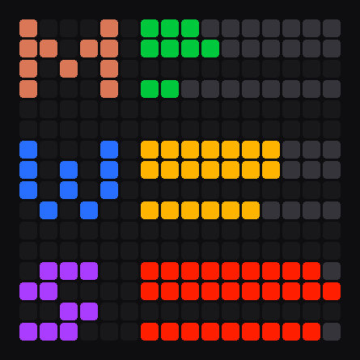

# ditoo-claude-usage

Claude subscription usage limits shown live on a **Divoom Ditoo Pro** pixel display: up to three accounts, with the 5‑hour session and weekly limits for each, refreshed every two minutes over Bluetooth.

<p align="center">
  
</p>

## What you see

Each account has a 4‑row block:

```
M  ▓▓▓░░░░░░░   ← 5h session, 2 rows, 20 cells × 5%
   ▓▓▓▓░░░░░░     (fills column by column: bottom pixel, then top)

   ▓▓░░░░░░░░   ← weekly, 1 row, 10 cells × 10%
```

- **Letter**: which account it is, drawn in that account's color.
- **Bar color**: green below 60%, amber below 85%, red from 85%.
- **Red letter, no bars**: no fresh data for 30+ minutes, usually because the account needs to log in again. Short API hiccups such as `429` keep showing the last known values.

## How it works

- **Usage data** comes from the same endpoint the Claude apps use to show plan limits (`/api/oauth/usage`), authenticated with an OAuth token per account.
- **Logins** use OAuth PKCE (`auth.py`). Each account gets its own token pair in `~/.ditoo/`, independent of any other Claude session on the machine, and the token is refreshed automatically.
- **Display**: the Ditoo exposes a Bluetooth serial port (SPP). Windows maps it to a COM port, and frames are written to it using the Divoom protocol (static 16×16 image, command `0x44`).
- **Sleep and shutdown**: a hidden window listens for Windows power and session events. On sleep, shutdown or logoff, the screen brightness goes to 0 and the keyboard backlight turns off. Both come back on wake or the next logon.

## Requirements

- Windows 10/11
- Python 3.10+
- Divoom Ditoo Pro paired over Bluetooth. Check **Device Manager → Ports** for the *Standard Serial over Bluetooth link* COM port.
- One to three Claude Pro / Max / Team accounts

## Setup

```powershell
git clone https://github.com/MishaStoyanov/ditoo-claude-usage.git
cd ditoo-claude-usage
pip install -r requirements.txt
copy config.example.json config.json   # set COM port, account names, letters, colors
```

Log in each account named in `config.json`:

```powershell
python auth.py start personal          # prints a URL
# open it in a browser where that account is signed in → Authorize → copy the code
python auth.py finish personal "<code>"
```

> Use a separate browser profile or a private window for each account. Otherwise the code is issued for whichever account is currently signed in.

Install the background task, which starts at logon and restarts on failure:

```powershell
powershell -ExecutionPolicy Bypass -File install.ps1
```

To remove it later, run `uninstall.ps1`.

## Configuration

`config.json`:

| Key | Default | Meaning |
|---|---|---|
| `port` | `COM3` | Bluetooth serial port of the Ditoo |
| `interval_seconds` | `120` | refresh period |
| `brightness` | `100` | screen brightness restored on wake (0–100) |
| `accounts` | — | 1–3 entries of `{ name, letter, color }`, listed top to bottom |

`letter` is any A–Z, drawn with the 4‑pixel font in `font.py`. `color` is a hex RGB value.

## Device control

`kb.py` talks to the device directly. It pauses the monitor while it holds the port and restarts it afterwards.

```powershell
python kb.py next | prev [n]   # keyboard backlight preset
python kb.py toggle            # keyboard backlight on/off
python kb.py off | on          # same as sleep / wake: screen + keyboard dark / back
python kb.py note "<text>"     # label the current preset; list / goto <pos|text> to jump back
```

The device doesn't report its current backlight preset, so `kb.py` counts presses locally. Switching presets with the device buttons desyncs the count; run `kb.py here <pos>` to re-sync.

## Files

| File | Purpose |
|---|---|
| `ditoo_usage.py` | monitor: fetch, render, push, sleep/wake handling |
| `auth.py` | OAuth login and token refresh |
| `power.py` | Windows power and session notifications |
| `font.py` | 4‑pixel letter glyphs |
| `kb.py` | manual device control |
| `tools/preview.py` | regenerates `docs/preview.png` |

Runtime state lives in `~/.ditoo/`: tokens, the last known usage values and `monitor.log`.

## Protocol notes

All packets use the same framing:

```
01 | len (2 B, LE) | cmd | args… | checksum (2 B, LE) | 02
```

`len` counts the command byte, the arguments and the checksum. The checksum is the sum of the length, command and argument bytes.

| Cmd | Args | Effect |
|---|---|---|
| `0x74` | brightness 0–100 | screen brightness |
| `0x44` | `00 0A 0A 04` + frame | static 16×16 image |
| `0x23` | `00` / `01` / `02` | keyboard backlight: previous preset / next preset / on‑off toggle |

The Ditoo has no command for the keyboard backlight color or brightness; those come with the presets.

## Disclaimer

This is an unofficial hobby project, not affiliated with Anthropic or Divoom. The usage endpoint is undocumented and may change without notice.

## License

[MIT](LICENSE)
